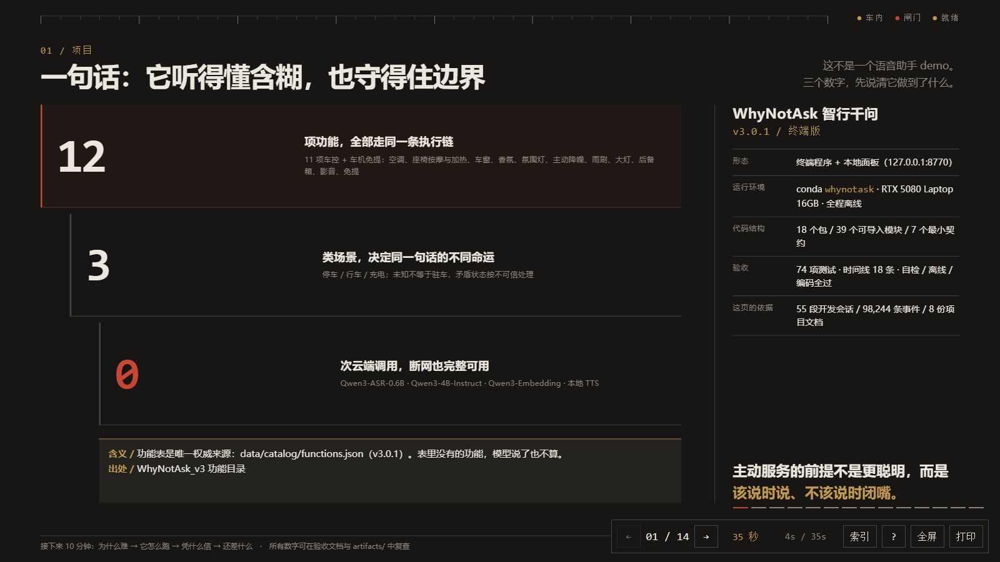

# WhyNotAsk 智行千问 · 项目讲解

一个车载主动服务助手（全链路离线）的 14 页交互式讲解稿，单文件 HTML，无需构建、无需联网。

**在线观看：** `https://<你的用户名>.github.io/<仓库名>/`

---

## 这份稿子讲什么

| 页 | 主题 |
|---|---|
| 01 | 项目一句话：12 项功能 / 3 类场景 / 0 次云端调用 |
| 02 | 为什么难：主动 vs 打扰、生成 vs 可控、离线 vs 能力 |
| 03 | 两张手稿：V2.0 的用户主动交互链、V3.0 的 Δ 打分 |
| 04 | 系统结构：三条链路 + 状态模型 |
| 05 | 判断原理：听见 → 理解 → 判断 → 闸门 → 执行 |
| 06 | 现场算一次：可拖的 Δ 计算器（七滑块 + 五预设） |
| 07 | 安全层：九步检查 + 一次真实的拒绝演示 |
| 08 | 证据·理解：holdout 60.4% / 81.2% / 39.6% / 0% 超时 |
| 09 | 证据·工程：10,367 MB 共驻、7 ms 首音、361 轮 0 错误、6.0 s 端到端 |
| 10 | 运行期事故：时间戳回绕 / 绿灯陷阱 / 12 秒长回复 |
| 11 | 硬件边界：还没上真车的四件事 |
| 12 | 版本更迭：V1（创客马拉松获奖）/ V2 / V3.0 |
| 13 | 商业化封装：三层封装 + 共用底座 + 三步路径 |
| 14 | 收尾 |

全片按 **10 分钟** 排期（合计 9 分 45 秒）。

## 怎么用

- 打开页面，按 `F` 全屏即进入放映状态；舞台 1920×1080，自动等比缩放。
- `→` `空格` 下一页，`←` 上一页，`Home` / `End` 首末页，`1`–`9` 直接跳页。
- `O` 幻灯片索引，`?` 快捷键表，`P` 打印 / 导出 PDF。
- 手机 / 平板：左右滑动翻页。
- 地址可直接深链接到某页：`#6` 计算器、`#7` 安全层、`#12` 版本。

若干页可以点：第 6 页的滑块与预设、第 7 页的「行车 / 停车」双场景、第 10 页的「看全部 18 条」。

## 技术说明

- **单文件**：CSS/JS/截图全部内联，零外部请求、零 CDN、零字体文件，断网也能放映。
- 只依赖浏览器本身（Chrome / Edge 110+ 均可）。
- 页面里的数字来自项目自身的验收材料与实测记录。

## 许可

内容与文案归项目作者所有，未附开源许可；如需引用请先联系作者。
